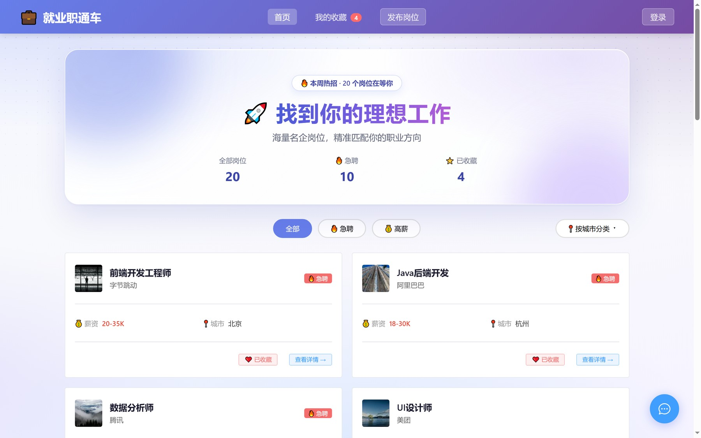
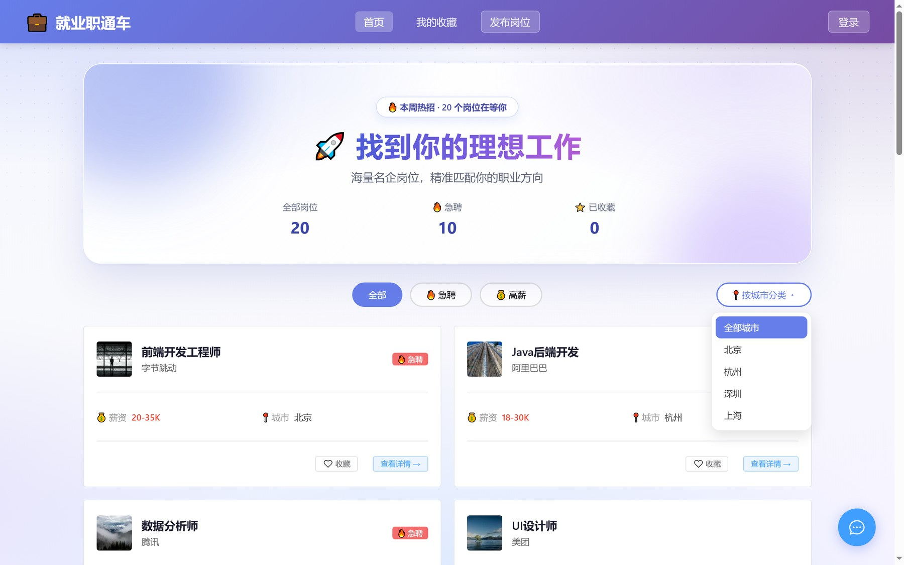
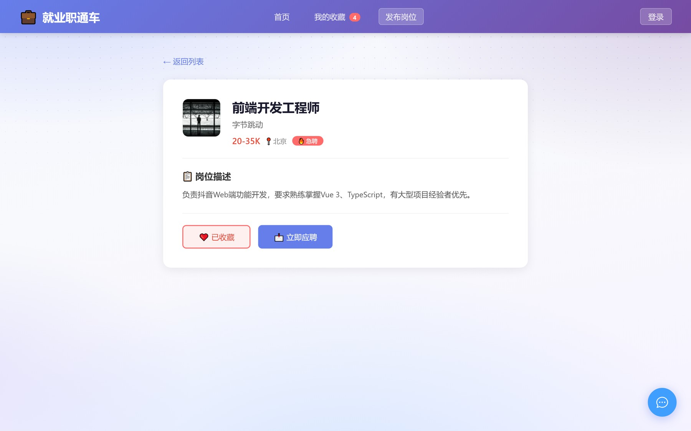
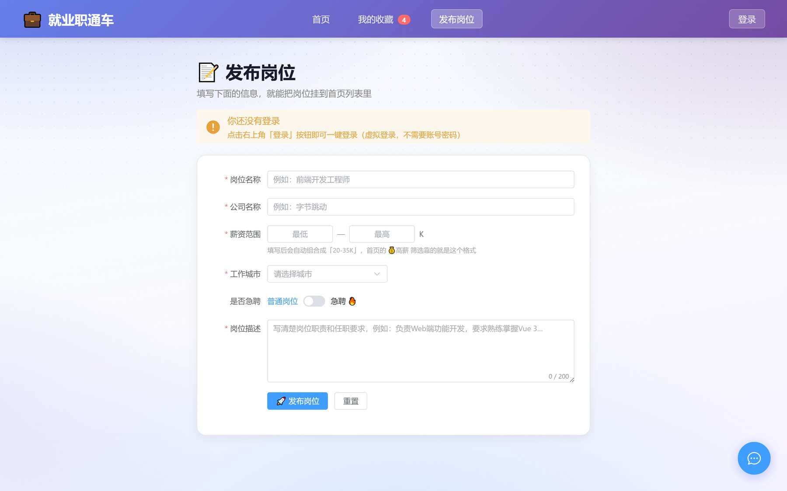
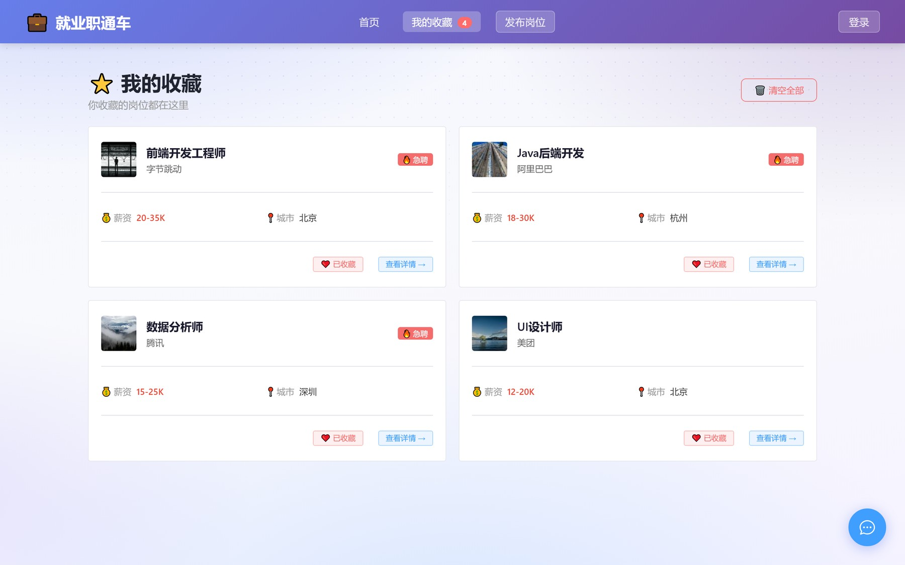
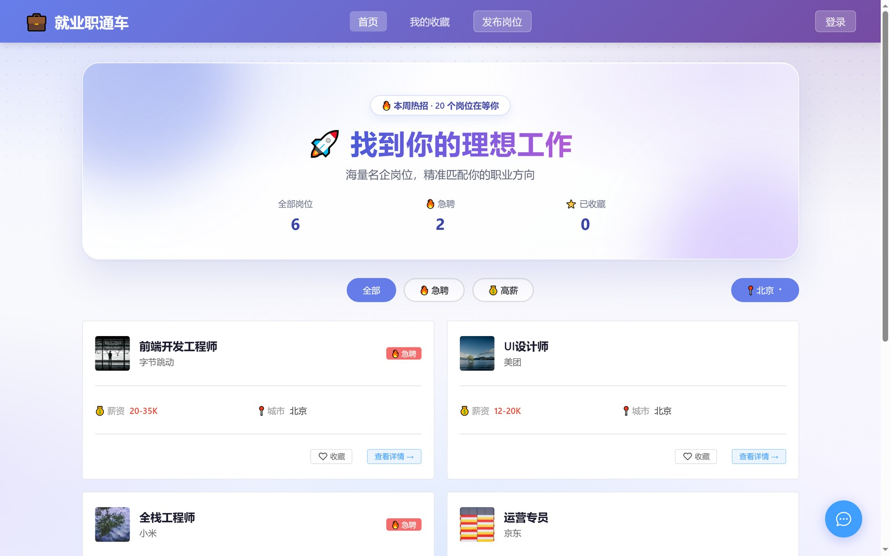
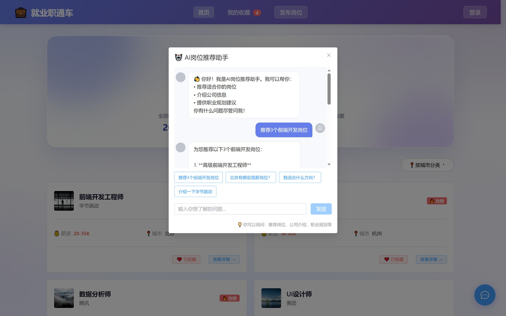

# 就业职通车（job-portal）· 岗位聚合与求职辅助单页应用

> 《Vue 3 项目实战》课程项目（2026 年秋季，第 1–7 周完成）。纯前端实现，20 条 Mock 岗位数据，支持浏览、筛选、收藏、发布、虚拟登录与 AI 求职助手。
>
> **在线演示**：https://job-portal-ya3h.vercel.app
> （未配置 AI Key，右下角 AI 助手显示「【演示环境】…」为正常降级，其余功能全部可用）


## 一、项目简介

就业职通车是面向计算机、软件技术专业应届生与实习生的岗位聚合页面：把「找岗位 — 筛岗位 — 收藏 — 问 AI」集中在同一页面，解决招聘信息分散、筛选维度单一、收藏刷新即丢失的问题。

项目为纯前端实现，不依赖后端服务，数据保存在浏览器 `localStorage` 中，完整练习了组件化、路由、状态管理与接口调用等 Vue 3 核心能力。

## 二、功能列表

| 模块 | 说明 | 状态 |
|---|---|---|
| 岗位列表 | 20 条 Mock 数据，卡片展示薪资、城市、急聘标签 | ✅ |
| 类型筛选 | 全部 / 急聘 / 高薪（20K 以上） | ✅ |
| 城市筛选 | 北京 / 上海 / 杭州 / 深圳，可与类型筛选叠加 | ✅ |
| 岗位收藏 | 卡片与详情页均可收藏，导航栏显示数量角标 | ✅ |
| 我的收藏页 | 收藏列表 + 空状态引导 | ✅ |
| 岗位详情 | 动态路由 `/job/:id`，返回列表 | ✅ |
| 发布岗位 | 表单校验（名称、薪资区间、城市、描述），写入本地 | ✅ |
| 数据持久化 | 收藏、发布岗位、登录态写入 localStorage，刷新保留 | ✅ |
| 虚拟登录 | 一键切换登录态并持久化 | ✅ |
| AI 求职助手 | 悬浮入口 + 对话框，接入 DeepSeek API，快捷问题、加载与错误提示 | ✅ |
| 服务器部署 | 本地 `npm run build` 通过，未部署线上（课程第 8 周范围外） | ⬜ |

## 三、技术栈

- **框架**：Vue 3（Composition API / `<script setup>`）+ Vite
- **路由**：Vue Router 4（4 条路由，详情页使用动态参数）
- **状态管理**：Pinia（`jobStore` / `authStore`）
- **UI**：Element Plus 2.14 + 自定义渐变/玻璃拟态视觉
- **请求**：Axios
- **持久化**：localStorage
- **AI**：DeepSeek Chat API（`/v1/chat/completions`，`deepseek-chat`）

## 四、目录结构

```
job-portal/
├── src/
│   ├── api/              deepseek.js（DeepSeek 对话请求、错误分类）
│   ├── assets/           静态资源
│   ├── components/       Header / FilterBar / JobList / JobCard / AIAssistant / Footer
│   ├── mock/             data.js（20 条岗位数据）
│   ├── router/           index.js（4 条路由）
│   ├── stores/           jobStore.js / authStore.js
│   ├── views/            HomeView / FavoritesView / JobDetailView / PostView
│   ├── App.vue
│   ├── main.js
│   └── style.css
├── .env                  本地环境变量（API Key，已加入 .gitignore）
├── index.html
├── package.json
└── vite.config.js
```

## 五、本地运行

```bash
# 1. 安装依赖（Node 18+）
npm install

# 2. 配置 AI 助手密钥：项目根目录新建 .env
VITE_DEEPSEEK_API_KEY=你的DeepSeek密钥

# 3. 启动
npm run dev     # 默认 http://localhost:5173

# 4. 生产构建（已验证通过）
npm run build
```

> ⚠️ `.env` 不要提交到仓库；`.gitignore` 中需包含 `node_modules/`、`dist/`、`.env`。
> AI 助手为可选功能，未配置密钥时其余功能均可正常使用。

## 六、实现要点

1. **组件拆分与双 v-model**：`FilterBar` 同时承担类型与城市筛选，子组件声明 `modelValue` / `city` 两个 props 和对应 `update:*` 事件，父组件用 `v-model` + `v-model:city` 绑定；少声明一个就会出现"点了没反应"。
2. **筛选与统计联动**：列表渲染 `filteredJobs` 计算属性，统计数字也基于筛选结果计算，而不是直接读 `totalJobs`，否则筛选后数字不动。
3. **localStorage 容错**：读取统一 `JSON.parse(localStorage.getItem(KEY) || '[]')`；发布岗位数据额外用 `try/catch` + `Array.isArray` 兜底，避免本地数据被改坏时整页白屏。
4. **动态路由参数类型**：`route.params.id` 是字符串，与数字 id 比较前必须 `parseInt`，否则详情页永远显示"加载中"。
5. **AI 对话健壮性**：请求统一加 `timeout: 30000`；按 401 / 429 / 402 / 超时分别抛可读错误并由 `ElMessage` 提示；发送前过滤首条欢迎语并补 system 人设，避免接口返回 400。
6. **Element Plus 与自定义视觉**：卡片 / 标签 / 表单交给 Element Plus，筛选按钮与渐变背景保留自定义，再用 scoped `:deep()` 微调，避免"后台管理"感。

## 七、运行截图

| 图 | 说明 |
|---|---|
|  | 首页：导航、Hero 统计、筛选栏与岗位卡片 |
|  | 收藏 4 个岗位后：按钮变为"已收藏"，导航栏出现角标 4 |
|  | FilterBar：类型筛选居中，右侧为自行扩展的城市下拉 |
|  | 岗位详情页 `/job/1`：动态路由参数、收藏与返回 |
|  | 扩展的发布岗位页：表单校验、薪资区间与城市选择 |
|  | 我的收藏页：刷新后仍有 4 条收藏，角标同步 |
|  | Element Plus 美化后的首页：统计、卡片、标签与渐变背景 |
|  | AI 助手实际对话：快捷问题"推荐 3 个前端开发岗位" |

## 八、已知限制

- 数据为 Mock 数据，未接后端接口，岗位不真实；
- 未部署线上（本地构建通过），如需演示请本地 `npm run dev`；
- `VITE_` 前缀的环境变量会在构建时内联进 JS，**正式上线必须改为后端代理转发**，不能把带 Key 的 dist 公开；
- 第 8 周内容（服务器、Nginx、云安全组）未开展。

## 九、我负责的部分

课程项目按执行手册第 1–7 周逐周完成：项目搭建、Mock 数据、Pinia 状态与持久化、组件拆分、路由与详情页、Element Plus 美化、DeepSeek 接入，以及额外扩展的城市筛选、岗位发布、虚拟登录；过程中遇到的问题（双 v-model 不生效、localStorage 数据异常白屏、接口 400 与 loading 卡死、动态路由 id 类型不一致）均通过控制台与最小复现定位并修复。
